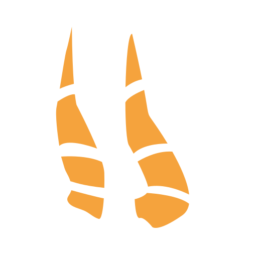

<div align="center">
  <h1>NecrassRs & Reed</h1>
  
  
  <p>Your schema leads. Rust delivers.</p>
  <a href="https://github.com/Necrass-Dev/NecrassRs/actions/workflows/rust.yml"></a>
  <a href="https://sonarcloud.io/summary/new_code?id=Necrass-Dev_NecrassRs"></a>
</div>

This workspace contains Reed, a GraphQL compiler toolkit for Rust, and NecrassRs, an SDL-first GraphQL server framework built on Reed.

## Projects

### Reed

Reed provides GraphQL parsing, schema and executable-document models, validation, introspection, and input coercion. Its packages can be used independently of NecrassRs by tools and applications that need GraphQL language support.

- [`reed-parser`](crates/reed-parser/README.md) provides lexical analysis, parsing, and concrete syntax trees. Read its [API documentation](https://docs.rs/reed-parser/) or view it on [crates.io](https://crates.io/crates/reed-parser).
- [`reed-compiler`](crates/reed-compiler/README.md) builds on the parser with validated schemas and executable documents, diagnostics, introspection, and input coercion. Read its [API documentation](https://docs.rs/reed-compiler/) or view it on [crates.io](https://crates.io/crates/reed-compiler).

### NecrassRs

NecrassRs turns GraphQL SDL into Rust resolver contracts during Cargo builds and executes requests through application-owned resolvers and HTTP integration. Applications keep control of routing, request context construction, and business logic.

Install the project initializer from crates.io:

```sh
cargo install necrassrs-cli --locked
necrass init my-api
```

See the [NecrassRs README](crates/necrassrs/README.md) for the framework workflow, the [documentation website](https://necrass.rs/docs/) for guides, or the [`necrassrs` API documentation](https://docs.rs/necrassrs/) for the execution API.

## How the projects fit together

NecrassRs uses `reed-compiler` to parse and validate SDL and GraphQL operations. `reed-compiler` uses `reed-parser` for syntax trees. Direct NecrassRs users receive the public GraphQL types they need through `necrassrs`; consumers that build GraphQL tooling can depend on either Reed package directly.

All eight public packages share one workspace version and release together:

| Package | Responsibility |
| --- | --- |
| [`reed-parser`](https://docs.rs/reed-parser/) | GraphQL lexical analysis, parsing, and concrete syntax trees |
| [`reed-compiler`](https://docs.rs/reed-compiler/) | GraphQL schema and document models, validation, introspection, and input coercion |
| [`necrassrs`](https://docs.rs/necrassrs/) | GraphQL requests, execution, resolver errors, and responses |
| [`necrassrs-build`](https://docs.rs/necrassrs-build/) | SDL validation, Rust generation, and resolver source synchronization |
| [`necrassrs-axum`](https://docs.rs/necrassrs-axum/) | Axum request extraction, response conversion, and GraphiQL |
| [`necrassrs-actix`](https://docs.rs/necrassrs-actix/) | Actix Web request extraction, response conversion, and GraphiQL |
| [`necrassrs-http`](https://docs.rs/necrassrs-http/) | Framework-independent HTTP response negotiation shared by the adapters |
| [`necrassrs-cli`](https://docs.rs/necrassrs-cli/) | The `necrass init` project initializer |

## Contributing

Read the [contribution guide](https://necrass.rs/docs/contributing/) and [AI usage policy](AI_POLICY.md) before making changes. To browse the workspace API documentation locally, run:

```sh
cargo doc --workspace --no-deps --locked --open
```

## Status

Reed and NecrassRs are pre-1.0 and under active development. APIs may change between releases.
