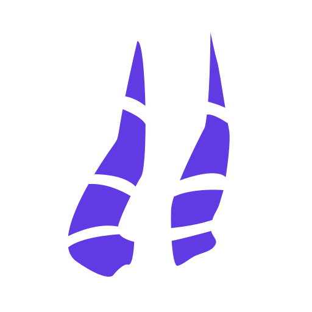

  <h1><code>necrassrs-axum</code></h1>
  

`necrassrs-axum` provides Axum request extraction, GraphQL response conversion, response media-type negotiation, and a GraphiQL HTML helper for application-owned routes.

Applications construct their own request context and call the [`necrassrs`](https://docs.rs/necrassrs) execution API from an Axum handler. See the [installation guide](https://necrass.rs/docs/installation/) for a complete server setup.

## License

Licensed under the [MIT License](LICENSE.md).
