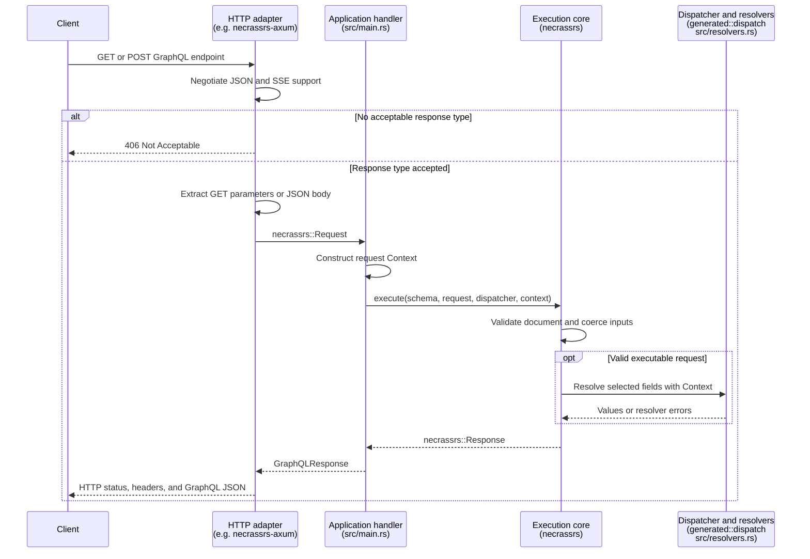

NecrassRs integrates with backend frameworks through HTTP adapters. An adapter connects a framework's request and response types to the GraphQL execution core, so you can serve GraphQL alongside the rest of your application.

## How it works

Applications own routing, middleware, shared state, and per-request Context construction. Register a GraphQL handler on an application-chosen route; the adapter extracts its request and converts its response.

For a GET query or JSON POST request, the flow is:

1. The framework routes the request to your GraphQL endpoint and applies application middleware.
2. The adapter checks response media-type preferences and extracts GET parameters or the JSON body into a `necrassrs::Request`.
3. Your handler constructs Context and calls `necrassrs::execute` with the validated schema, request, dispatcher, and Context.
4. The execution core parses and validates the GraphQL document, selects an operation, coerces variables, and invokes resolvers through the dispatcher.
5. The adapter serializes the returned `necrassrs::Response` and sets the HTTP status and response headers.

This sequence shows the request and response boundaries. The adapter's extraction and response conversion run within the application's framework route.



`necrassrs-build` generates resolver contracts and the dispatcher from SDL during the Cargo build; it is not part of the HTTP request flow. At startup, the application validates `generated::SDL` with `necrassrs::Schema::parse_and_validate` and stores the schema and dispatcher in shared state. Each handler borrows that state and supplies its own Context. Authentication, database connections, and other request-specific values remain application concerns.

The execution core does not depend on an HTTP framework or on `necrassrs-http`. An adapter does not need to generate code or implement GraphQL execution. To configure introspection, the handler can call `execute_with_options`; see [GraphiQL](https://necrass.rs/docs/graphiql/).

## Subscription transports

The runtime supports subscriptions through `necrassrs::subscribe`, which returns
a stream of GraphQL responses after creating the event source. See
[Subscriptions](/docs/subscriptions/) for generated resolvers, a runnable console
example, error handling, and cancellation.

The current Axum and Actix adapters handle single-response HTTP execution. They
do not provide WebSocket or Server-Sent Events (SSE) subscription transports.
Serving a GraphiQL page does not add a subscription endpoint.

A subscription transport must consume the response stream, encode its events,
handle startup and terminal errors, and drop the stream when the client cancels
or disconnects. The application owns authentication, Context lifetime, external
producer buffers, and any reconnection or replay policy.

## Supported frameworks

The following adapters are maintained in this repository:

| Backend framework | Adapter crate     | CLI `--framework` value | Usage                               |
| ----------------- | ----------------- | ----------------------- | ----------------------------------- |
| Axum              | `necrassrs-axum`  | `axum`                  | [Axum integration](#axum)           |
| Actix Web         | `necrassrs-actix` | `actix`                 | [Actix Web integration](#actix-web) |

For a new project, use `necrass init <PATH> --framework <FRAMEWORK>` with a value from the table. See [Create a project](https://necrass.rs/docs/installation/#create-a-project) for package naming and interactive setup.

For an existing application, add its adapter dependency and register a handler as shown below. The [Axum example](https://github.com/Necrass-Dev/NecrassRs/tree/main/examples/axum-server) and [Actix Web example](https://github.com/Necrass-Dev/NecrassRs/tree/main/examples/actix-server) include manifests, build scripts, SDL, and resolver implementations.

Put `necrassrs`, the chosen adapter, and the application's framework and runtime
in `[dependencies]`; put `necrassrs-build` in `[build-dependencies]` for `build.rs`.
The separately installed CLI is not a consumer dependency. Include generated
contracts from `OUT_DIR`, and parse `generated::SDL` once during server startup
for reuse across requests. Keep the executable's `panic = "abort"` profiles from
the examples: selecting an unimplemented resolver terminates the process, while
ordinary resolver errors produce GraphQL responses. Library Cargo profiles do
not propagate to applications.

If your framework is not listed, you can [write an adapter](#writing-an-adapter) using the same public runtime API.

## Using an adapter

For request and field tracing, see [OpenTelemetry](/docs/opentelemetry/).
The application configures HTTP parent spans, the subscriber, and the exporter;
the GraphQL adapters do not initialize telemetry.

Both maintained adapters expose `GraphQLRequest` and `GraphQLResponse`. The request wrapper contains the runtime request; the response wrapper accepts the result of execution. The examples below assume application state named `AppState` with `schema` and `dispatcher` fields, as in the consumer examples, and use `()` as Context.

`necrassrs-http` contains the response media-type selection shared by both adapters. It parses `Accept` preferences, applies quality and specificity rules, and handles explicit exclusions. It does not execute GraphQL, read request bodies, run a server, or own application routes. Applications normally depend on their adapter, which brings this package transitively.

### Axum

Extract shared state and the GraphQL request in your handler:

```rust
use std::sync::Arc;
use axum::extract::State;
use necrassrs_axum::{GraphQLRequest, GraphQLResponse};

async fn graphql(
    State(state): State<Arc<AppState>>,
    GraphQLRequest(request): GraphQLRequest,
) -> GraphQLResponse {
    let context = ();
    GraphQLResponse(
        necrassrs::execute(&state.schema, &request, &state.dispatcher, &context).await,
    )
}
```

Place `GraphQLRequest` last in the handler's extractors because POST extraction consumes the body. Configure body limits with Axum's `DefaultBodyLimit`.

Attach `negotiate_response` using the GraphQL method router's `route_layer`. This applies negotiation only to registered methods and preserves 405 responses for unsupported methods regardless of `Accept`. It keeps the existing `GraphQLRequest(request)` and `GraphQLResponse(response)` handler API:

```rust
use axum::{Router, middleware, routing::get};
use necrassrs_axum::{graphiql_html, negotiate_response};

let app = Router::new()
    .route("/graphql", get(graphql).post(graphql).route_layer(middleware::from_fn(negotiate_response)))
    .route("/graphiql", get(|| async { graphiql_html("/graphql") }))
    .with_state(state);
```

Axum's `IntoResponse` receives no request headers. The middleware reads `Accept` before invoking the handler and sets the content type only on responses produced by `GraphQLResponse`. Framework rejections and other responses retain their own formats. It appends `Vary: Accept` without replacing existing `Vary` values.

Without this middleware, `GraphQLResponse` preserves the existing `application/json` response behavior. The axum-server example and CLI template include the middleware. Mount it on the GraphQL route rather than wrapping GraphiQL HTML routes.

### Actix Web

`GraphQLRequest` implements Actix's `FromRequest`; `GraphQLResponse` implements `Responder`. The extractor checks acceptable response types before GraphQL execution, and the responder reads `Accept` directly from `HttpRequest`. No additional negotiation middleware is needed.

Use `web::Data` for application state and construct Context inside the handler. Configure JSON limits with `web::JsonConfig::limit`. Standard JSON extraction errors follow the [HTTP status contract](/docs/graphql-over-http/#status-and-error-contract); custom JSON error handlers returning other error types retain their own responses.

```rust
use actix_web::web;
use necrassrs_actix::{GraphQLRequest, GraphQLResponse};

async fn graphql(
    state: web::Data<AppState>,
    GraphQLRequest(request): GraphQLRequest,
) -> GraphQLResponse {
    let context = ();
    GraphQLResponse(
        necrassrs::execute(&state.schema, &request, &state.dispatcher, &context).await,
    )
}

fn configure(cfg: &mut web::ServiceConfig) {
    cfg.service(
        web::resource("/graphql")
            .route(web::get().to(graphql))
            .route(web::post().to(graphql)),
    );
}
```

Register `configure` on your `App` and attach state with `.app_data(web::Data::new(state))`. Consume the body only once: other handler extractors must not read it again.

Both adapters also provide an optional `graphiql_html` helper. Register it on an application-owned GET route separately from GraphQL execution; see [Introspection and GraphiQL](https://necrass.rs/docs/graphiql/).

## HTTP behavior

The [GraphQL over HTTP manual](/docs/graphql-over-http/) describes the maintained
adapters against the September 2026 specification, including request support,
HTTP 294, framework limitations, and verification coverage.

### Media types

Send JSON request bodies and prefer `Accept: application/graphql-response+json`.
Both adapters also support legacy `application/json`. See the
[media negotiation contract](/docs/graphql-over-http/#media-types) for quality
weights, missing headers, legacy error labeling, and `Vary: Accept`.

### Status and error contract

Error-free execution uses 200. Execution with errors uses 294 for both JSON
representations, including `data: null`; request errors remain 4xx. See the
[complete status table](/docs/graphql-over-http/#status-and-error-contract) and
[294 compatibility guidance](/docs/graphql-over-http/#http-294-and-compatibility).

## Writing an adapter

An adapter can live in your application or in a separate crate. There is no adapter registration API or required adapter trait in the execution core. Implement your framework's native extraction and response conversion interfaces, or perform the conversion in a handler. The `GraphQLRequest` and `GraphQLResponse` names are conventions used by the maintained adapters.

Use these implementations as references:

- [Axum adapter source](https://github.com/Necrass-Dev/NecrassRs/blob/main/crates/necrassrs-axum/src/lib.rs): `FromRequest`, `IntoResponse`, and negotiation middleware.
- [Actix Web adapter source](https://github.com/Necrass-Dev/NecrassRs/blob/main/crates/necrassrs-actix/src/lib.rs): `FromRequest`, `Responder`, and negotiation through the request object.
- [Shared HTTP source](https://github.com/Necrass-Dev/NecrassRs/blob/main/crates/necrassrs-http/src/lib.rs): framework-independent response media-type selection.

### Extract the request

Use your framework's JSON parser and body-limit configuration. A POST body must be an object containing a required string `query`, optional object `variables` and `extensions`, and an optional string `operationName`; ignore unknown properties. The maintained adapters accept `null` for optional fields and treat it as absent. For GET, URL-decode `query` and `operationName`, parse `variables` and `extensions` as JSON objects, and normalize empty optional parameters as absent. Reject malformed JSON, missing or incorrectly typed fields, unsupported content types, and oversized bodies using the [status contract](#status-and-error-contract).

Construct `Request::new(query)`, then call `with_variables(variables)` and `with_operation_name(operation_name)` when those values are present. Use `necrassrs::JsonMap` for variables. Request construction does not validate GraphQL; pass the request to execution and let the runtime handle document validation and coercion.

### Negotiate the response type

Depend directly on `necrassrs-http` to reuse `response_media_types`. Pass all `Accept` header values as strings, preserving multiple values. An empty iterator means the header is absent and selects legacy `application/json`. Reject malformed values and requests that accept neither JSON nor SSE before GraphQL execution. `response_media_type` remains available when only ordinary JSON negotiation is needed.

Negotiation needs access to the incoming headers. If your framework's response conversion interface cannot access the request, select the type in route middleware or carry it from extraction to response conversion. Apply negotiation to the GraphQL execution route, preserving framework method rejections and separate HTML routes.

### Convert the runtime response

Let the application handler call `execute` or `execute_with_options`; it owns the schema, dispatcher, and Context. Convert the returned `Response` using its public classification methods:

1. `requires_response_stream()` selects 406 for ordinary JSON delivery.
2. Otherwise, `is_syntax_error()` selects 400.
3. Otherwise, `is_request_error()` selects 422.
4. Otherwise, `is_execution_error()` selects 294, including partial data and `data: null` with errors.
5. Error-free execution selects 200.

Serialize `Response` directly with Serde. Use the negotiated media type, switching a non-2xx response to `necrassrs_http::GRAPHQL_JSON` only when `ResponseMediaTypes::legacy_json` is true. Include `Vary: Accept` without discarding existing values. Keep framework extraction errors separate from GraphQL response serialization.

Use the runtime classification methods rather than matching diagnostic text, counting serialized errors, or checking whether `data` is null. Those approaches lose the distinction between request and execution errors. Leave resolver errors, field paths, and null propagation to the runtime.

### Verify and document the integration

Exercise the adapter through your framework's HTTP test utilities. Cover request fields and types, variables and operation selection, per-request Context, the status table, and negotiation with absent, repeated, weighted, excluded, and invalid `Accept` values. Check that unacceptable response types prevent execution, body-limit configuration still works, and unrelated routes retain their own behavior.

The [Axum HTTP tests](https://github.com/Necrass-Dev/NecrassRs/blob/main/crates/necrassrs-axum/tests/http.rs) and [Actix Web HTTP tests](https://github.com/Necrass-Dev/NecrassRs/blob/main/crates/necrassrs-actix/tests/http.rs) provide concrete cases. Include a runnable consumer showing handler registration, application state, and Context construction, and document any transport limitations or differences from this contract.

A reusable adapter does not automatically become a CLI option. To add a maintained framework to this repository, add its adapter and tests to the Cargo workspace, supply a consumer example, and update this page's support table. If the CLI should generate projects for it, also add its framework choice, starter files, and generated-project checks in `necrassrs-cli`.

## Scope and verification

Use the [GraphQL over HTTP verification guidance](/docs/graphql-over-http/#verification-coverage)
for adapter and real HTTP consumer checks. The maintained behavior follows the
September 2026 edition; the [documented limitations](/docs/graphql-over-http/#limitations-and-deployment-boundaries)
remain part of the support contract. Neither these tests nor an external checker
establish complete HTTP conformance.
